<div align="center">

# SANDUN · PPT

**做了 10 多年 PPT，我终于有了自己的插件。**

AI 封面 · AI 生图 · AI 图表 · AI 图示 · 30 多项效率工具 · PowerPoint 与 WPS 通用

[](LICENSE)


[下载安装包](../../releases) · [产品介绍](https://sandun.cc/ppt-plugin) · [修复工具](#插件维护中心修复工具) · [源码构建](#源码构建)

</div>

---

做了十多年 PPT，三顿一直想有一个自己的 PPT 插件。

原以为接入 AI 最难，真正折磨人的却是 WPS 兼容：想加几个常用功能，这里报错，那里失效。后来干脆把整个插件交给 OpenAI 的新模型 Astra 重写，只用了一个周末，兼容问题解决了，还多了不少惊喜。

于是有了 SANDUN · PPT：把 SANDUN 同款的 **AI 封面、AI 生图、AI 图表、AI 图示**，和三顿多年来高频使用的**效率工具**，一起放进 PowerPoint 和 WPS 的功能区。现在，它开源了。

## ✨ AI 功能

AI 功能接入你自己的 OpenAI-compatible 模型，文本和图片模型分开配置。

### 🎨 AI 封面

输入主题，AI 先策划四个方案，再生成标题 SVG 和图片背景，最后分层插入幻灯片。得到的是一张**可编辑**的 16:9 封面：标题是文字，背景是图片，都能接着改。

<p align="center">
  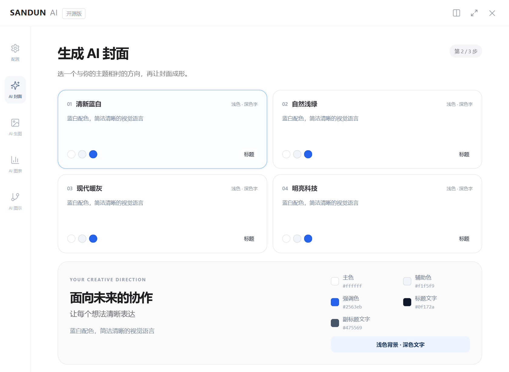
  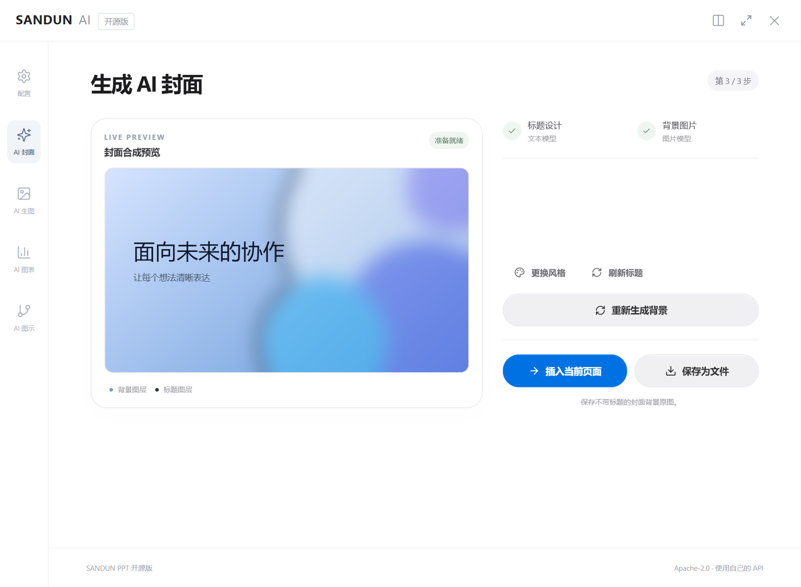
</p>

### 🖼️ AI 生图

一句话描述画面，生成后可以插入幻灯片或另存。使用 `gpt-image-2.5-sunburst` / `gpt-image-2.5-flare` 时，还可以调画面比例、清晰度、画质、格式和透明背景，并上传最多 4 张参考图，指定主体、配色或构图（[详细说明](#ai-生图图片设置与参考图)）。

<p align="center">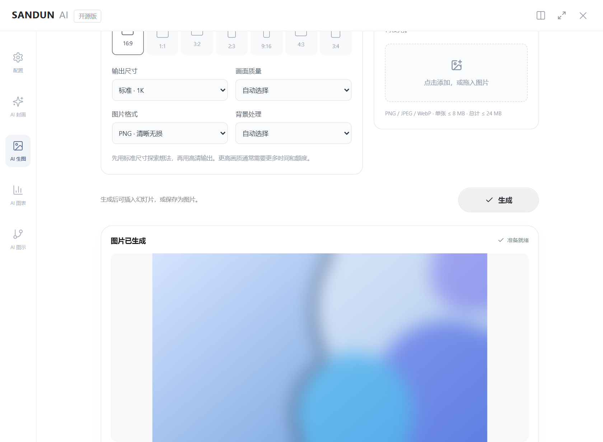</p>

### 📊 AI 图表

把数据直接说出来，比如“一季度 20，二季度 40，三季度 60”。AI 整理数据，插件在本机渲染成 SVG 图表插入页面，可以随意移动和缩放。

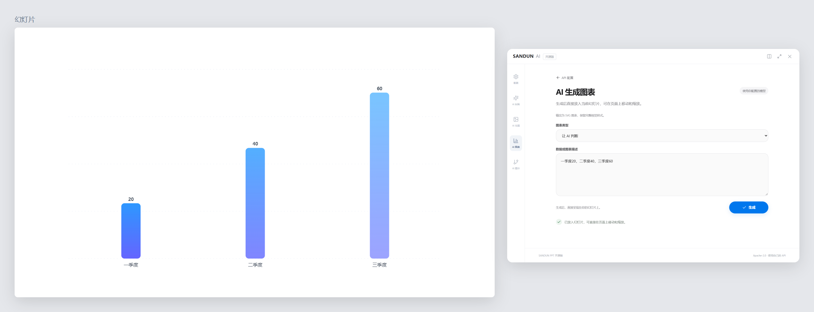

### 🧭 AI 图示

把一段逻辑变成一张图。默认“智能识别”，AI 判断内容是简单关系还是复杂关系；也可以手动指定类型：

- **简单关系**：时间轴、流程递进、循环、包含、对比、交集、汇聚/发散
- **复杂关系**：条件流程、架构、时序、生态、金字塔/漏斗

简单图示内置 122 个母版、464 个数量版本，按真实的节点数选版式，不会硬塞。生成结果经过 SVG 安全和语法校验，出错会自动修正一次。

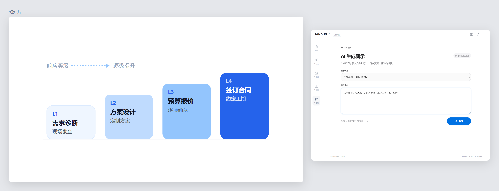

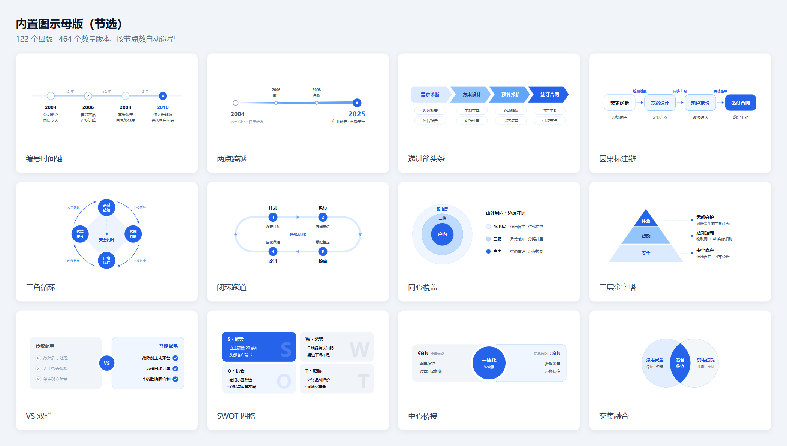

> 以上截图来自插件真实界面，模型返回内容为模拟数据。

## 🧰 效率工具

这些是三顿做 PPT 时高频使用的功能，有的来自多年前喜欢、但已经停更的插件，这次全部用 Astra 重新实现，所有弹窗也重新设计了。

**整体缩放**：灵感来自三顿推荐过很多次的「小顽简报」。同时调整多组文字和形状的大小以前很费劲，现在选中元素，就能在原位置等比放大或缩小。在原功能基础上还加了：

- 缩放基点：选区中心或四个角，五选一
- 参与缩放的范围：对象间距、字体、线宽，以及阴影、发光、映像、柔化效果，都可以单独开关

**一键圆角**：灵感来自小众的「英豪工具箱」。选中任意形状点一下，所有端点都会变成圆角，文字和样式保持不变。

**布尔运算**：联合、组合、拆分、相交、剪除。这类功能原本主要在 Office 里用，现在 WPS 里也能用。

**统一字体**：中文、英文分别指定字体，三种模式统一全篇。

**超级刷**：读取一次样式，按属性刷给多个对象。

**PPT 拼图**：多页拼成一张长图，可以加背景和水印。

<p align="center">
  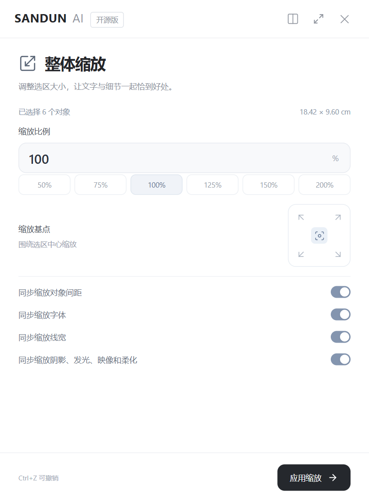
  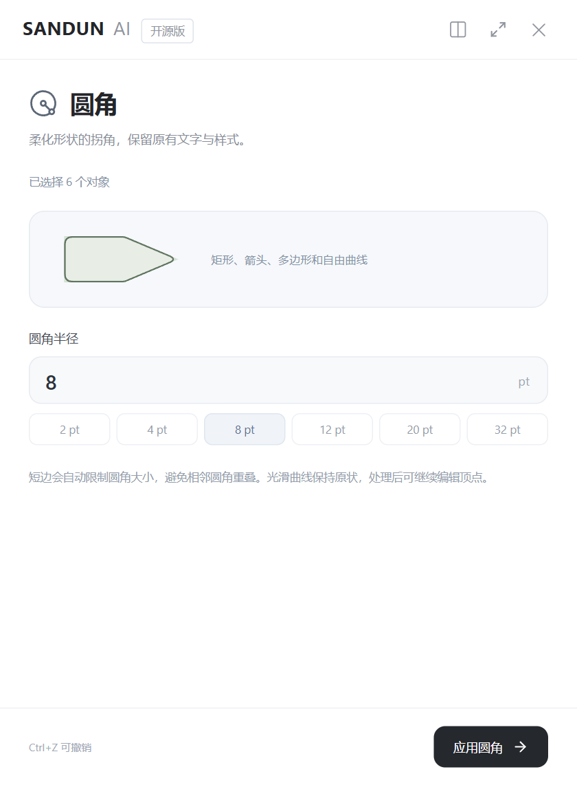
  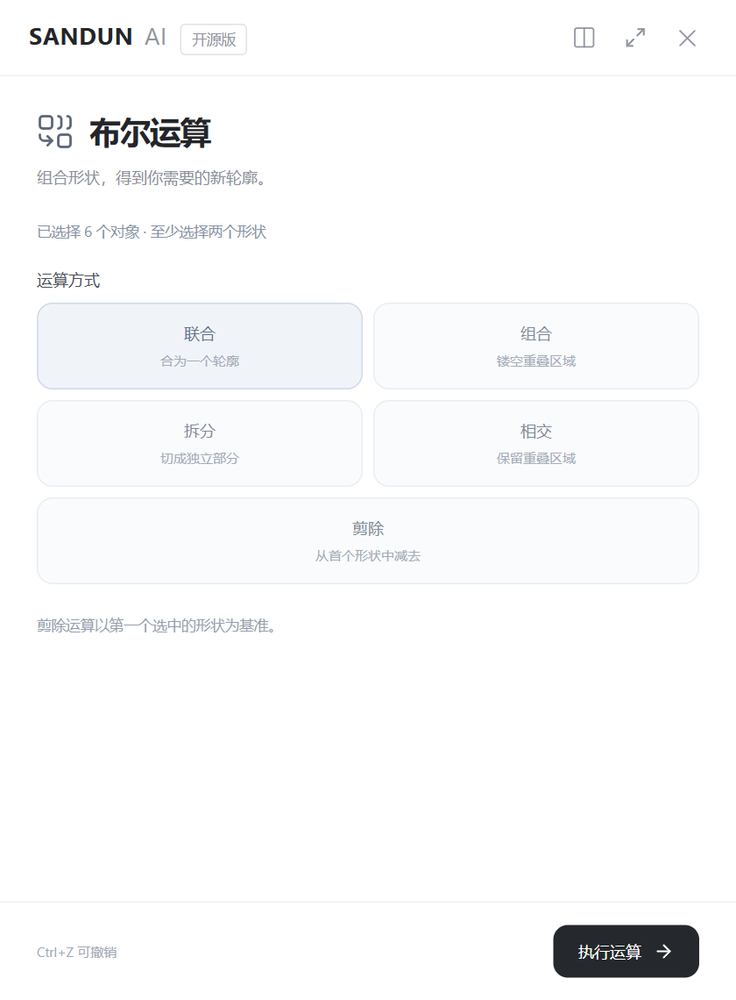
</p>
<p align="center">
  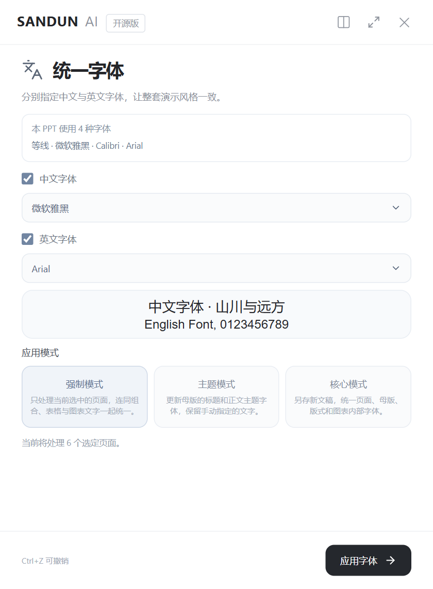
  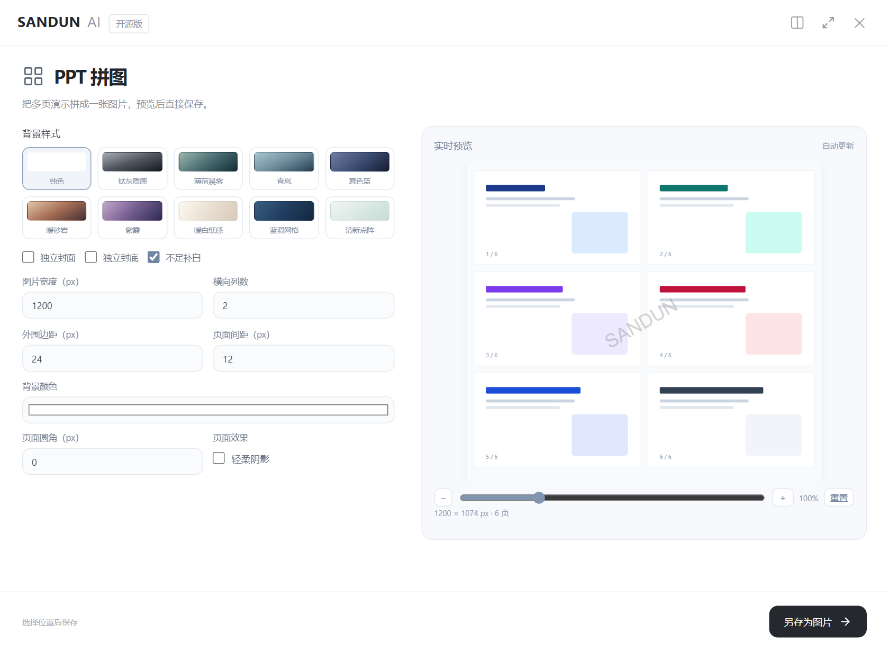
</p>

<details>
<summary><b>全部工具清单</b></summary>

- **视图**：页面撑高、参考线、母版设置、整体缩放
- **选择**：图层管理、连选、反选、相同类型、相同字体/字号、相同宽度、相同高度、相同颜色、所有线条、所有文字、所有组合
- **组合**：亲密性组合、组合保留样式、取消组合保留样式、解散页面组合、解散选定组合
- **排列与编辑**：上层、下层、原位复制、填充画面、全屏裁剪、修边、遮罩
- **高级**：布尔运算、圆角、统一字体、超级刷
- **导出**：PPT 拼图、导出图片（600 DPI）、导出选定页视频（1080p）、导出字体、字体转曲

个别工具受 WPS 宿主能力限制，在 WPS 中不可用。

</details>

## 🚀 快速开始

1. 在 [Releases](../../releases) 下载 `SANDUN-PPT-OpenSource-Setup-2.0.2.exe` 并安装，然后重新打开 PowerPoint 或 WPS。
2. 在功能区找到 **SANDUN** 选项卡，点击 **配置**。
3. 分别填写文本模型和图片模型的 **接口地址**、**API Key** 和 **模型名称**，保存后点 **校验连通性**。
4. 开始使用 AI 封面、生图、图表和图示。

**模型配置说明**

- 接口地址填 API 根路径，通常以 `/v1` 结尾。文本走 `/chat/completions`，图片走 `/images/generations`；图片结果支持 base64 或公开 HTTPS 下载 URL。
- 默认文本模型是 `gpt-5.6-luna`，默认图片模型是 `gpt-image-2.5-sunburst`。这些只是可修改的模型标识，能否调用取决于你的服务商。
- 连通性校验会真实调用模型，图片校验会生成一张测试图，可能产生服务商费用。插件本身不收费，也没有积分。

**运行环境**：Windows 10/11、Microsoft PowerPoint 或 WPS 演示、.NET Framework 4.8、WebView2 Runtime。

## AI 生图：图片设置与参考图

图片模型是 `gpt-image-2.5-sunburst` 或 `gpt-image-2.5-flare` 时（不区分大小写，兼容服务商前缀和日期版本），AI 生图会额外显示：

- **比例**：16:9、1:1、3:2、2:3、9:16、4:3、3:4；尺寸分标准和高清两档，界面上显示实际像素，默认 16:9、1536×864。
- **画质**：自动、低、中、高、超高、最高。
- **格式与背景**：PNG / JPEG（JPEG 可设置 0–100 的压缩质量）；背景可选自动、不透明或透明（透明背景自动使用 PNG）。
- **参考图**：最多 4 张 PNG/JPEG/WebP，单张不超过 8 MB，总计不超过 24 MB（插件本地限制）。支持拖入、预览和删除；参考图只随本次请求发送，不写入配置。

有参考图时以 multipart 上传到 `/images/edits`，没有参考图时用 `/images/generations`。生成失败**不会**自动去掉参考图重试，以免偏离你的本意。其他图片模型继续使用原来的横向 `1536x1024` 请求；封面生成不受这些设置影响。参数依据 [OpenAI 图片生成文档](https://developers.openai.com/api/docs/guides/image-generation)。

## 🔐 隐私与安全

- 本地服务只监听回环地址（`127.0.0.1:17667`），带 CSRF 校验。
- API Key 用 Windows DPAPI 按当前用户加密保存。界面和 GET 配置接口都不会返回明文。
- 切换服务地址时必须重新填写 Key，防止把旧服务的凭据发到新地址。
- 模型返回的图片在本机下载后再嵌入，Key 不会发给图片 CDN。
- 安装包和源码里没有任何用户 Key、登录令牌、证书私钥或项目数据。

## 插件维护中心（修复工具）

`SANDUN-PPT-RepairTool.exe` 用来解决“功能区不显示”“WPS 不加载插件”这类问题。源码在 [`repair-tool/`](repair-tool)。

<p align="center">
  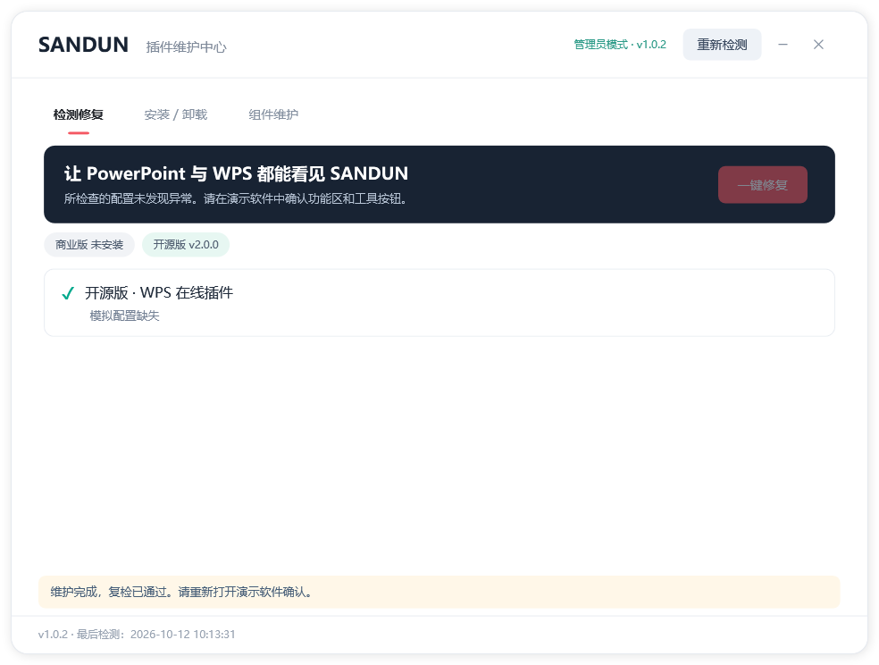
  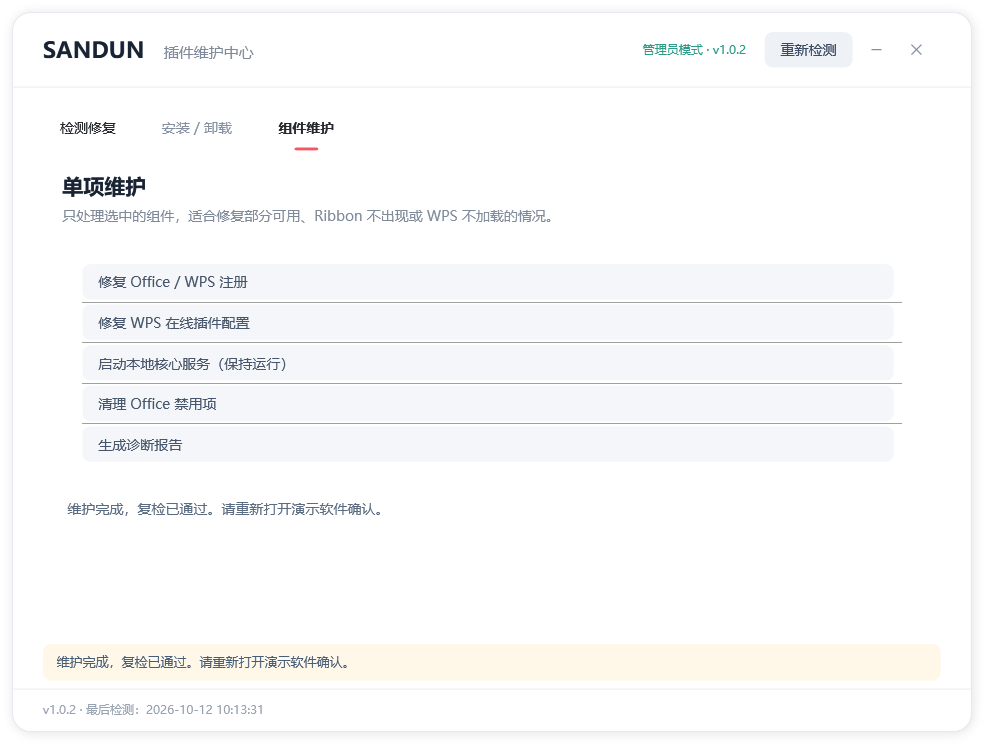
</p>

- **检测修复**：检查插件文件、PowerPoint 加载项、WPS 在线插件、WPS COM 桥接、本地 HTTPS 健康状态、演示软件进程和系统环境。可以逐项修复，也可以一键修复，完成后自动复检。
- **安装 / 卸载**：调用同目录下的对应安装包。
- **组件维护**：单独修复 Office/WPS 注册、WPS 在线插件配置、启动本地核心服务、清理 Office 禁用项、生成诊断报告。

使用前请保存并关闭 PowerPoint 和 WPS。工具需要管理员权限，用来读取和修复 Office/WPS 注册表、WPS 插件配置和本地服务。WPS 配置修复失败时会保留备份；诊断报告保存在 `%LOCALAPPDATA%\SANDUN\RepairReports`。

构建需要 .NET 8 SDK：

```powershell
cd repair-tool
dotnet publish -c Release -r win-x64 --self-contained -p:PublishSingleFile=true
```

## 📦 安装隔离

插件使用独立的 COM 注册、安装目录 `SANDUNPPTOpenSource` 和端口 `17667`，用户数据位于 `%LOCALAPPDATA%/SANDUNPPTOpenSource`。WPS 的功能区资源由独立的本地核心提供，安装时会配置当前用户的启动项；卸载时会移除对应的启动项和注册信息。

## 源码构建

依赖：Python 3.12、Node.js（支持 Vite 8）、Windows .NET Framework 编译器、Office PIA、Inno Setup 6。WebView2 SDK 和 Extensibility 互操作程序集已放在 `native/lib`，第三方条款见 [`licenses/`](licenses)。

```powershell
./scripts/setup-dev.ps1
./scripts/build-installer.ps1
```

构建只用插件目录。`scripts/dev-env.ps1` 会把开发缓存和临时运行数据放到 `.work`，不需要后端、数据库或任何 API Key。最终产物在 `release`。

### 测试

```powershell
. ./scripts/dev-env.ps1
./.venv/Scripts/python.exe -m pytest --basetemp=.work/pytest -q
cd taskpane; npm test; cd ..
./.venv/Scripts/python.exe scripts/test-ui-server.py
# 另一个终端：
node scripts/test-open-ui.cjs
node scripts/test-image-options-ui.cjs
./scripts/test-open-native.ps1 -HostKind office
./scripts/test-open-native.ps1 -HostKind wps
```

UI 测试使用隔离的模型响应，不调用真实付费服务。原生测试会新建测试文稿，结束时只关闭测试文稿。测试报告见 [docs/VALIDATION.md](docs/VALIDATION.md)，架构说明见 [docs/ARCHITECTURE.md](docs/ARCHITECTURE.md)。

### 目录结构

```
├── src/ppagent_local/   本地 FastAPI 服务、模型调用、提示词与图示母版（prompts/）
├── taskpane/            React + Vite 插件界面
├── native/              Office/WPS 原生组件（C#）：功能区、WebView2 窗口、对象工具
├── manifests/wps/       WPS 加载项清单
├── installer/           Inno Setup 安装脚本
├── packaging/           PyInstaller 打包配置
├── repair-tool/         插件维护中心（.NET 8 WPF）
├── scripts/             构建、测试、打包脚本
└── tests/               Python 测试
```

提示词和简单图示库在 `src/ppagent_local/prompts`，可以单独审阅和修改。

## 🙏 致谢

感谢下面两个开源项目，SANDUN · PPT 从中得到了很多启发：

- **[小顽简报](https://www.yuque.com/wonvy/pptools/veu9yq)**：开源免费的 PPT 插件，三顿推荐过很多次。整体缩放、布尔运算等功能的灵感都来自它。
- **[fireworks-tech-graph](https://github.com/yizhiyanhua-ai/fireworks-tech-graph)**：把自然语言转成技术图表的 Agent Skill（MIT），为 AI 图示的图表类型和 SVG 生成思路提供了重要借鉴。

同时感谢 [`licenses/`](licenses) 中列出的所有第三方开源组件。

## 📄 许可证

项目代码以 [Apache License 2.0](LICENSE) 发布，详见 [NOTICE](NOTICE)。第三方组件继续沿用各自的许可证。Microsoft Office、WPS 和 WebView2 是独立产品，不因本项目改变授权。
